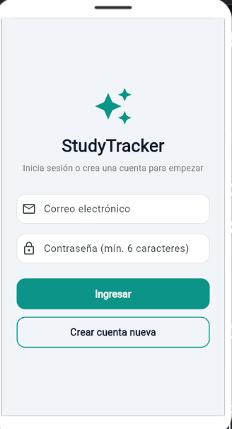
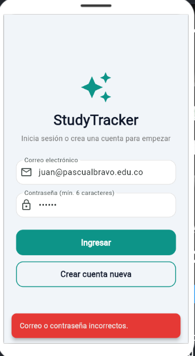
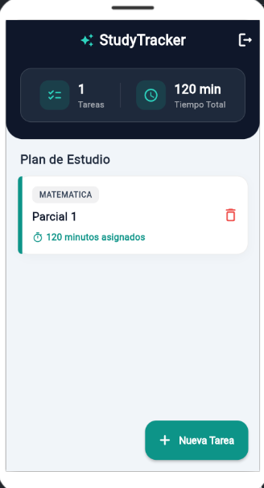
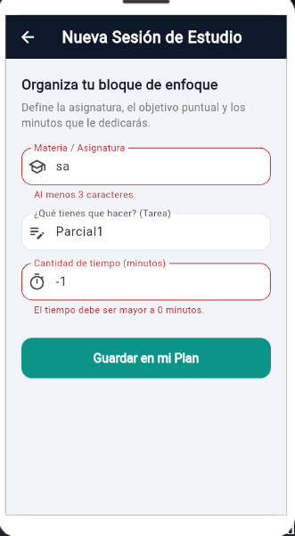

# StudyTracker - Control y Gestión de Sesiones de Estudio

**Desarrollado por:** Juan Lozada  
**Asignatura:** ET0126 - Programación de Dispositivos Móviles (I.U. Pascual Bravo)

---

## 📌 Propósito y Problema que Resuelve
La idea de **StudyTracker** nace de la necesidad personal de administrar eficientemente el tiempo disponible entre el trabajo y el estudio. Para estudiantes con agendas apretadas, es fundamental mantener claridad sobre las tareas pendientes y asignarles un tiempo específico de dedicación.

Esta aplicación permite registrar sesiones de estudio con la materia correspondientes, la tarea exacta a realizar y el tiempo estimado en minutos, facilitando la organización diaria y el enfoque.

---

## 🔄 Evolución del Proyecto (Taller 1 vs. Taller 2)

| Característica | Primera Versión (Taller 1) | Versión Actual (Taller 2) |
| :--- | :--- | :--- |
| **Ingreso de Datos** | Estático (agregaba automáticamente "Estudiar Flutter"). | Formulario interactivo con entradas de texto y número. |
| **Campos** | Únicamente un título genérico. | Materia, tarea detallada y duración en minutos. |
| **Validación** | Sin validaciones. | Uso de `form_field_validator` y regla de negocio (minutos > 0). |
| **Arquitectura** | Todo en un solo archivo `main.dart`. | Arquitectura modular dividida en `models`, `services`, `widgets` y `screens`. |
| **Manejo de Datos** | Lista en memoria simple. | Servicio asíncrono (`Future`, `async/await`, `Future.delayed`) simulando API. |
| **Manejo de Errores/UX** | Sin alertas visuales. | Indicadores de carga, mensajes de validación, snackbars y control de duplicados. |

---

## ⚙️ Estructura del Código

- `lib/models/sesion_estudio.dart`: Modelo tipado Dart que representa los atributos de una sesión de estudio.
- `lib/services/sesion_service.dart`: Servicio asíncrono en memoria. Simula peticiones HTTP a un backend con tiempos de espera (`Future.delayed`) y valida reglas de negocio (previene tareas duplicadas).
- `lib/widgets/sesion_card.dart`: Widget reutilizable (`StatelessWidget`) para renderizar cada ítem de la lista.
- `lib/screens/crear_sesion_screen.dart`: Formulario interactivo (`StatefulWidget`) administrado con `GlobalKey<FormState>`, validadores de campos y control contra doble envío.
- `lib/main.dart`: Pantalla principal que coordina el ciclo de vida, la carga asíncrona de datos (`initState`), y el despliegue del formulario.

---

## 🧠 Declaración de Uso de Inteligencia Artificial

Durante el desarrollo de la segunda fase de **StudyTracker**, utilicé la Inteligencia Artificial como un **asistente de programación y consulta técnica** para resolver los siguientes retos complejos:

1. **Arquitectura y Limpieza de Rutas:** Configuración e importación correcta de archivos en proyectos modularizados estructurados en FlutLab.
2. **Validaciones de Formulario Complejas:** Implementación de reglas combinadas con `MultiValidator` (`RequiredValidator`, `MinLengthValidator`) y lógica de validación de dominio personalizada para convertir cadenas a números y garantizar tiempos mayores a 0 minutos.
3. **Manejo Asíncrono y Estado del Ciclo de Vida:** Control de excepciones con bloques `try/catch/finally`, manejo de estados ocupados (`_guardando`) para evitar envíos duplicados al presionar rápidamente, y verificación de `mounted` antes de invocar `setState` o navegar tras completar operaciones con `await`.

---

## 🧪 Pruebas Manuales Obligatorias

| Caso | Acción | Resultado Esperado | Resultado Obtenido |
| :--- | :--- | :--- | :--- |
| **Campos vacíos** | Presionar "Guardar" sin escribir datos. | Aparecen los mensajes de error bajo cada campo; no se llama al servicio. | **Pasó correctamente** |
| **Texto muy corto** | Escribir menos de 3 o 4 caracteres en materia o tarea. | El validador exige una descripción más larga. | **Pasó correctamente** |
| **Regla de dominio** | Ingresar 0 o un valor negativo en la duración. | Muestra el mensaje: *"El tiempo debe ser mayor a 0 minutos"*. | **Pasó correctamente** |
| **Registro válido** | Diligenciar todos los campos correctamente y guardar. | Se muestra indicador de carga, notificación verde de éxito y se lista el registro. | **Pasó correctamente** |
| **Error de negocio** | Intentar registrar la misma tarea y materia dos veces. | Muestra mensaje rojo indicando que la tarea ya existe en el servicio. | **Pasó correctamente** |
| **Envío rápido** | Pulsar "Guardar" varias veces seguidas mientras procesa. | El botón se deshabilita con un spinner y solo crea una copia. | **Pasó correctamente** |
| **Reinicio de App** | Reiniciar o recargar la aplicación en el navegador. | Los registros en memoria regresan a su estado inicial simulado. | **Pasó correctamente (Comportamiento esperado en memoria)** |

---

## 📸 Capturas de la Aplicación

| Inicio de Sesión (Firebase) | Validación de Credenciales |
| :---: | :---: |
|  |  |

| Tablero Principal y Resumen | Nueva Sesión y Validaciones |
| :---: | :---: |
|  |  |